<a href="https://geometor.github.io/durer/"></a>

# GEOMETOR • durer

**Visit the Online Archive:** https://geometor.github.io/durer/

<p align="center">
  <a href="https://geometor.github.io/durer/"></a>
</p>

**Albrecht Dürer • Underweysung der Messung • semantic digital archive**

## Mission

`geometor/durer` is part of the interconnected [GEOMETOR](https://geometor.com) semantic digital archive. It liberates Albrecht Dürer's landmark 1525 treatise *Underweysung der Messung* from isolated print bounds into addressable semantic units, four synchronized reading tracks, calibrated theme-adaptive vector diagrams, primary-source folio provenance, and exact symbolic geometry demonstrations across the GEOMETOR corpus.

## Books in This Archive

- [Instruction in Measurement](https://geometor.github.io/durer/underweysung/) — *Underweysung der Messung* (Nuremberg, 1525 / Paris, 1532) featuring four synchronized bilingual reading tracks, polyhedral net reconstructions, and exact compass-and-straightedge models.

### Mathematical Demonstrations & Symbolic Modules

- **Book I**: Archimedean spirals and descriptive geometry of conics over $\mathbb{Q}(\sqrt{3})$.
- **Book II**: Regular and workshop polygons, rusty compass constructions, and circle quadrature.
- **Book III**: Classical Roman Antiqua typography and modular Textura minuscules.
- **Book IV**: Planar fold-out nets for Platonic and Archimedean polyhedra, Delian cube duplication, and central perspective projection.

## Repository Contents

- `docsrc/` — Four-track bilingual Book Codex, apparatus registries, and Sphinx docs compiled by [PHOTON publish](https://github.com/photon-platform/publish).
- `resources/` — Primary 300 DPI folio scans, structure maps, persons/citations registries, and review manifests.
- `src/geometor/durer/` — Exact symbolic construction modules, algebraic audits, and demonstration pipelines.

## Local Build & Verification

```bash
publish build
uv run --no-sync pytest
```
## Part of the GEOMETOR Knowledge Archive

Explore all **74 Book Codices** and **11 Mathematical Catalogs** at https://geometor.com/books/.
