GEOMETOR • durer
================

**Visit the Online Archive:** https://geometor.github.io/durer/

**Albrecht Dürer • Underweysung der Messung • semantic digital archive**

Mission
-------

``geometor/durer`` is part of the interconnected `GEOMETOR <https://geometor.com>`_ semantic digital archive. It liberates Albrecht Dürer's landmark 1525 treatise *Underweysung der Messung* from isolated print bounds into addressable semantic units, four synchronized reading tracks, calibrated theme-adaptive vector diagrams, primary-source folio provenance, and exact symbolic geometry demonstrations across the GEOMETOR corpus.

Books in This Archive
---------------------

- `Instruction in Measurement <https://geometor.github.io/durer/underweysung/>`_ — *Underweysung der Messung* (Nuremberg, 1525 / Paris, 1532) featuring four synchronized bilingual reading tracks, polyhedral net reconstructions, and exact compass-and-straightedge models.

Mathematical Demonstrations & Symbolic Modules
~~~~~~~~~~~~~~~~~~~~~~~~~~~~~~~~~~~~~~~~~~~~~~

- **Book I**: Archimedean spirals and descriptive geometry of conics over :math:`\mathbb{Q}(\sqrt{3})`.
- **Book II**: Regular and workshop polygons, rusty compass constructions, and circle quadrature.
- **Book III**: Classical Roman Antiqua typography and modular Textura minuscules.
- **Book IV**: Planar fold-out nets for Platonic and Archimedean polyhedra, Delian cube duplication, and central perspective projection.

Python Package & Modules
------------------------

The ``geometor-durer`` Python package (``import geometor.durer``) provides the executable symbolic geometry, construction, and compilation modules powering this archive:

- ``concordance.py`` — Scholarly apparatus & cross-corpus concordance loader for *Underweysung der Messung* (1525).
- ``conics_perspective.py`` — Exact symbolic constructions for Book I spirals & conic projections and Book IV perspective.
- ``polygons.py`` — Exact symbolic constructions & workshop audits for Book II regular polygons and quadrature.
- ``polyhedra.py`` — Exact symbolic planar polyhedral nets from Book IV of Dürer's *Underweysung der Messung* (1525).
- ``render.py`` — Theme-adaptive ``.euclid-graphic`` SVG renderer & figure generator for ``geometor.durer``.
- ``typography.py`` — Exact symbolic compass-and-straightedge typography from Book III of *Underweysung der Messung*.
- ``cli.py`` — Command-line interface for ``geometor.durer``.
- ``sphinx_ext.py`` — Runtime Sphinx & photon-platform/publish integration for GEOMETOR Dürer.

See the `API Reference <https://geometor.github.io/durer/modules/>`_ for full module documentation.

Repository Contents
-------------------

- ``docsrc/`` — Four-track bilingual Book Codex, apparatus registries, and Sphinx docs compiled by `PHOTON publish <https://github.com/photon-platform/publish>`_.
- ``resources/`` — Primary 300 DPI folio scans, structure maps, persons/citations registries, and review manifests.
- ``src/geometor/durer/`` — Exact symbolic construction modules, algebraic audits, and demonstration pipelines.

Local Build & Verification
--------------------------

.. code-block:: bash

   publish build
   uv run --no-sync pytest

Part of the GEOMETOR Knowledge Archive
--------------------------------------

Explore all **74 Book Codices** and **11 Mathematical Catalogs** at https://geometor.com/books/.
