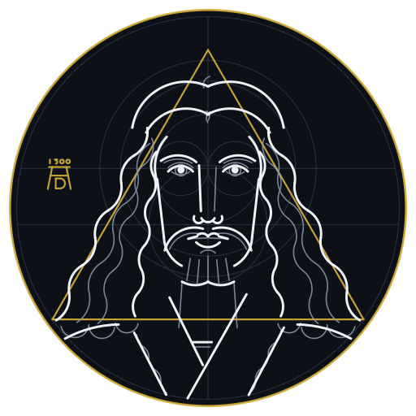

:site_title: Albrecht Dürer

.. container:: author-overline

   semantic digital archive • the works of

==============
Albrecht Dürer
==============

**Albrecht Dürer** (1471–1528), the Nuremberg master painter and printmaker, wrote *Underweysung der Messung* (*Instruction in Measurement*, 1525) to give artisans and architects a working manual of compass and straightedge. From Archimedean spirals and two-view conic projections to rusty-compass pentagons, Roman *Antiqua* lettering, and the first printed fold-out polyhedral nets in history, Dürer bridged Euclidean rigor and Renaissance workshop craft.

Books in This Collection
------------------------

.. container:: home-book-hero

   .. container:: home-book-thumb

      .. image:: _static/figures/book4_dodecahedron_net.svg
         :alt: Albrecht Dürer Book IV Dodecahedron Planar Fold-Out Net
         :target: underweysung/index.html

   .. container:: home-book-body

      .. rubric:: Nuremberg Edition · 1525 / Paris, 1532 · 4 Books · 4 Synchronized Tracks

      **Instruction in Measurement** (*Underweysung der Messung, mit dem Zirckel und Richtscheyt*) — All four books transcribed in Early New High German and English alongside **11 calibrated interactive vector plates** spanning conics, regular polygons, Roman capitals, polyhedral nets, and perspective apparatus.

      .. container:: home-actions

         * :doc:`Open Underweysung der Messung → <underweysung/index>`
         * :doc:`Book I (Spirals & Conics) → <underweysung/buch_01/index>`
         * :doc:`Book IV (Polyhedral Nets) → <underweysung/buch_04/index>`
         * :doc:`Symbolic Demos → <demos/index>`

Key Features
------------

.. container:: home-feature-grid

   .. container:: home-feature-card

      **Four-Track Bilingual Witness**

      Read Dürer's 1525 Nuremberg German alongside direct English translation, executive summaries, and scholarly notes referencing Camerarius's 1532 Latin edition.

   .. container:: home-feature-card

      **Workshop Craft & Polyhedral Nets**

      Inspect Book III's modular Roman capitals and Gothic *Textura* minuscules alongside Book IV's iconic planar fold-out nets for Platonic and Archimedean solids.

   .. container:: home-feature-card

      **Exact Symbolic Audits**

      Executable SymPy models in :doc:`demos/index` measure Dürer's single-aperture "rusty compass" pentagon against Euclid's :math:`\mathbb{Q}(\phi)` construction (:math:`+21.97'` discrepancy) and verify conic transfer symmetry.

Reference & Project
-------------------

.. container:: home-columns

   .. container:: home-col

      .. rubric:: Scholarly Apparatus

      * :doc:`People <underweysung/people/index>` — Profiles of Albrecht Dürer, Willibald Pirckheimer, Joachim Camerarius, Luca Pacioli, and Piero della Francesca
      * :doc:`Bibliography <underweysung/bibliography>` — 1525/1538 Nuremberg and 1532 Paris editions and scholarly apparatus
      * :doc:`Concordance <underweysung/concordance>` & :doc:`Glossary <underweysung/glossary>` — Cross-corpus links to Euclid, Apollonius, and Pacioli

   .. container:: home-col

      .. rubric:: About This Project

      * :doc:`About <about/index>` — Editorial scope, symbolic field invariants, and provenance
      * :doc:`Using This Edition <usage/index>` — Track switching, navigation, and collection layout
      * :doc:`Log <log/index>` & :doc:`Modules <modules/index>` — Development history and Python API reference

.. toctree::
   :maxdepth: 2
   :hidden:

   underweysung/index
   underweysung/people/index
   underweysung/bibliography
   about/index
   usage/index
   demos/index
   log/index
   modules/index
